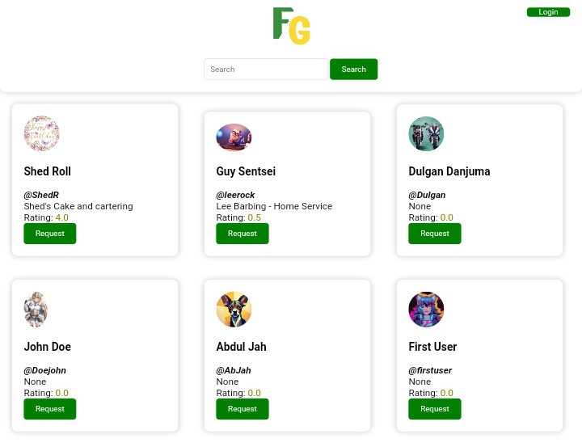
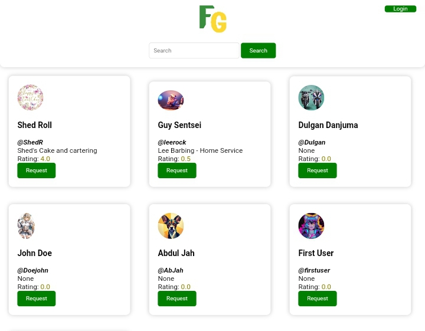
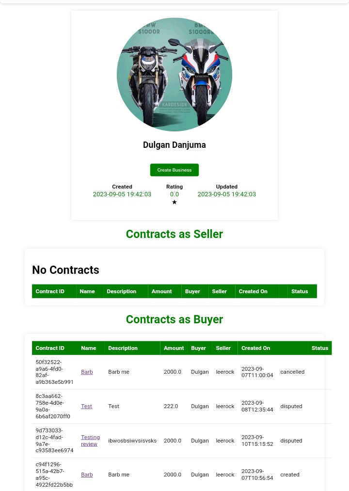
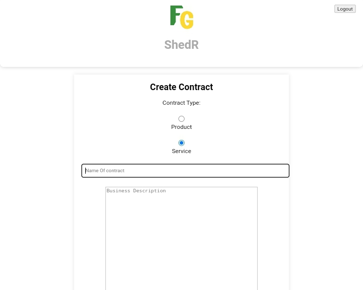
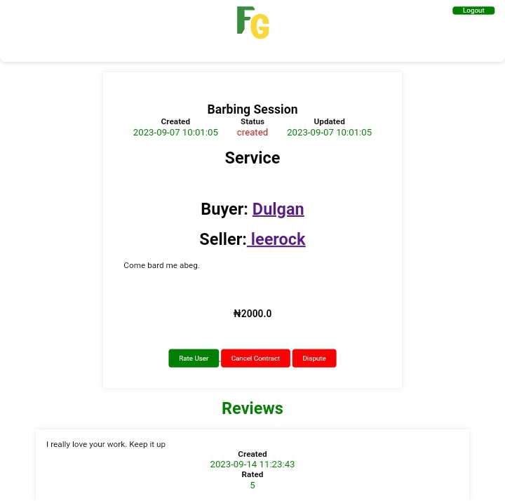
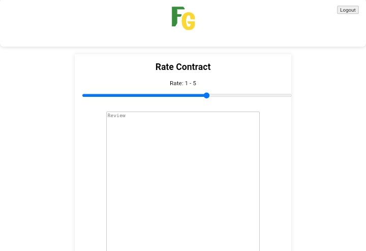

<div align="center">


# FlexiGuardian

**A trust layer between service providers and their clients: verified reviews, ratings and contract tracking.**


[Landing page](https://dulgan1.github.io/FlexiGuardian/landing_page) · [Features](#features) · [Getting started](#getting-started) · [Web routes](#web-routes) · [REST API](#rest-api) · [Screenshots](#screenshots)

</div>



## Overview

FlexiGuardian is the portfolio project that concluded the Foundations track of the **ALX Software Engineering programme** (powered by Holberton School). It was inspired by a personal experience with fraudulent vendors: the platform gives customers a safe place to rate and review businesses, lets business owners build a public reputation, and keeps both sides accountable through tracked contracts.

The application is backend-heavy. A single Flask app serves server-rendered pages for the web experience and a JSON API under `/api/v1`, both backed by SQLAlchemy models stored in MySQL.

## Features

- **Accounts** – registration with email and username uniqueness checks, hashed passwords (Werkzeug), session-based login for the web UI and JWT tokens (PyJWT) for the API.
- **Business profiles** – a user can register one business with an address; public profiles show the business details, reviews received and the average rating.
- **Search** – find users and businesses by name, username or business description straight from the home page.
- **Contracts** – a buyer opens a contract with a seller (product or service, description, amount). The seller initiates it and it moves through `created → ongoing → closed`, with `cancelled` and `disputed` paths.
- **Ratings and reviews** – once a contract exists the buyer can rate (1–5) and review the seller. Raising a dispute automatically posts a 0-star review with the reported issue, and the seller's average rating is recalculated after every review.
- **Dashboard** – logged-in users see their contracts as buyer and as seller, their business and their reviews in one place.

## Tech stack

| Layer | Technology |
|---|---|
| Language | Python 3 |
| Web framework | Flask with blueprints, Jinja2 templates, Flask-CORS |
| Data | SQLAlchemy ORM on MySQL (`mysqlclient` driver) |
| Authentication | Werkzeug password hashing, Flask sessions (web), PyJWT (API) |
| Front end | HTML, CSS |
| Serving | Gunicorn via `wsgi.py`, Nginx as the reverse proxy in production |

## Getting started

### Prerequisites

- Python 3.8 or newer
- A MySQL server with an empty database for the app

### Installation

```bash
git clone https://github.com/Blueskale/flexyguardian.git
cd flexyguardian
python3 -m venv venv && source venv/bin/activate
pip install -r requirements.txt mysqlclient
```

`mysqlclient` is not listed in `requirements.txt` but is required by the `mysql+mysqldb` connection string used in `models/engine/storage.py`.

### Environment configuration

| Variable | Purpose |
|---|---|
| `FG_MYSQL_USER` | MySQL user |
| `FG_MYSQL_PWD` | MySQL password |
| `FG_MYSQL_HOST` | MySQL host, for example `localhost` |
| `FG_MYSQL_DB` | Database name |
| `FG_SECRET_KEY` | Secret used to sign Flask sessions and JWT tokens |

```bash
export FG_MYSQL_USER=fg_dev FG_MYSQL_PWD=fg_dev_pwd FG_MYSQL_HOST=localhost FG_MYSQL_DB=fg_dev_db
export FG_SECRET_KEY='change-me-to-a-long-random-string'
```

All tables are created automatically the first time the app starts (`Base.metadata.create_all`).

### Run

```bash
python3 app.py                         # development server on http://0.0.0.0:5000
gunicorn --bind 0.0.0.0:5000 wsgi:app  # production-style server
```

## Web routes

| Route | Methods | Description |
|---|---|---|
| `/`, `/home` | GET, POST | Home page listing users by rating; POST runs a search |
| `/register` | GET, POST | Create an account |
| `/login`, `/logout` | GET, POST | Session login and logout |
| `/users/<user_name>` | GET | Public profile, or the dashboard when viewing your own |
| `/users/<user_name>/business` | GET, POST | Register a business profile (login required) |
| `/users/<user_name>/contracts/create` | GET, POST | Open a contract with a seller |
| `/<user_name>/contracts` | GET | Contracts as buyer and seller |
| `/contracts/<id>` | GET | Contract details |
| `/contracts/<id>/initiate` | POST | Seller starts the contract (`ongoing`) |
| `/contracts/<id>/close`, `/cancel`, `/dispute` | POST | Close, cancel or dispute a contract |
| `/contracts/<id>/rate` | GET, POST | Rate and review the seller |

## REST API

Base URL: `/api/v1`. Protected endpoints expect the JWT returned by `/login` in an `x-access-tokens` header (tokens expire after 30 minutes); an active browser session is accepted as well.

| Method | Endpoint | Auth | Description |
|---|---|---|---|
| POST | `/register` | – | Create an account (`name`, `email`, `phone`, `user_name`, `password`) |
| POST | `/login` | – | Obtain a JWT (`email`, `password`) |
| GET | `/users/<user_name>` | – | Public profile with business details and reviews |
| GET, PUT | `/users/<user_name>/profile` | ✔ | Read or update your own profile |
| GET | `/users/<user_name>/business` | – | Business details including address |
| POST | `/contracts/create` | ✔ | Create a contract (`c_type`, `s_user`, `b_user`, `name`, `desc`, `amount`) |
| GET | `/contracts/<id>` | ✔ | Contract details (buyer or seller only) |
| POST | `/contracts/<id>/rate` | ✔ | Rate and review the seller (`rate`, `review`) |
| POST | `/contracts/<id>/initiate` | ✔ | Seller updates the contract status |
| POST | `/contracts/<id>/dispute` | ✔ | Buyer disputes the contract (`issue`) |
| GET | `/<user_name>/contracts` | ✔ | Contracts as buyer and seller |

Example:

```bash
curl -X POST http://localhost:5000/api/v1/login \
     -H "Content-Type: application/json" \
     -d '{"email": "ada@example.com", "password": "secret"}'
```

## Screenshots

| Home | Dashboard |
|---|---|
|  |  |

| Create a contract | Contract view | Rate a seller |
|---|---|---|
|  |  |  |

## Project structure

```
flexyguardian/
├── app.py                 # Flask app factory-style entry point, registers both blueprints
├── wsgi.py                # Gunicorn entry point
├── api/v1/views/          # JSON API blueprint: user.py, contract.py, token.py (JWT decorator)
├── app_dynamics/          # Web blueprint: login.py, register.py, contract.py, auth.py
│   ├── templates/         # Jinja2 pages (home, dashboard, profile, contracts, auth)
│   └── static/styles/     # Stylesheets
├── models/                # SQLAlchemy models: User, Review, Business, Address, Contract
│   └── engine/storage.py  # MySQL storage engine (session handling, lookups)
├── landing_page/          # Static landing page and screenshots
└── requirements.txt
```

## Known limitations

- The API endpoints for `initiate` and `dispute` are incomplete (see the `TODO` in `api/v1/views/__init__.py`); the matching web routes work.
- Passwords are hashed with Werkzeug's `md5` method, which recent Werkzeug releases no longer support. Pin `Werkzeug<2.3` with a matching Flask 2.x, or switch the hashing call to `pbkdf2`/`scrypt`.
- Profile pictures are chosen from a fixed list at registration; there is no image upload yet.

## Authors

- **Princewill Mmadu** – [GitHub](https://github.com/Blueskale) · [LinkedIn](https://www.linkedin.com/in/princewillmmadu/)
- **Dulgan Danjuma** – [Twitter](https://twitter.com/DanjumaDulgan) · [LinkedIn](https://www.linkedin.com/in/dulgan-danjuma) · original repository: [dulgan1/FlexiGuardian](https://github.com/dulgan1/FlexiGuardian)

## License

Released under the [MIT License](LICENSE).
